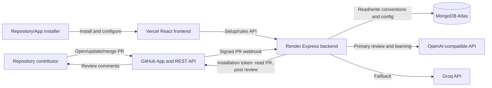
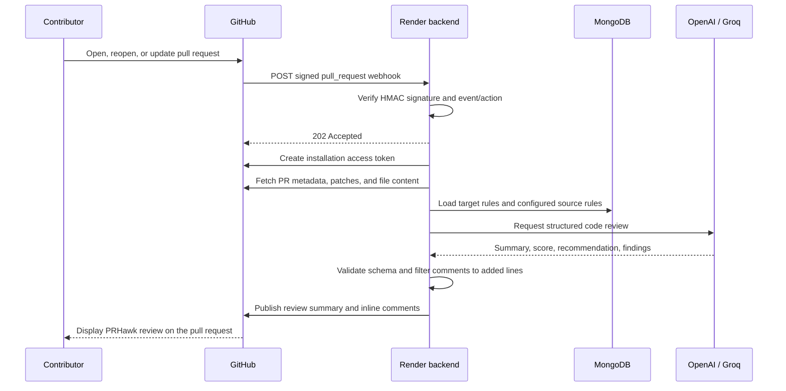
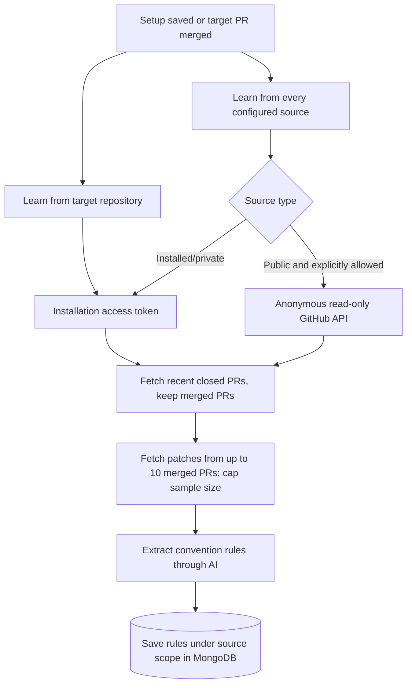
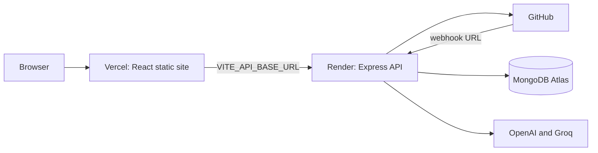

# PRHawk Architecture

## 1. Project summary

PRHawk is a GitHub App that automatically reviews pull requests with AI. Repository owners install the App on selected repositories. GitHub sends pull-request events to the PRHawk backend, which retrieves the change, loads repository conventions, asks an AI model to review it, and publishes the resulting summary and inline comments back to GitHub.

The deployed frontend is hosted on Vercel and the API is hosted on Render. The frontend provides an installation landing page and a setup/rules management page. GitHub remains the place where code reviews are read.

## 2. System context



## 3. Main components

### Frontend — React and Vite

Source: `frontend/src/`

- `App.jsx` routes `/setup` to the setup page and all other paths to the landing page.
- `pages/LandingPage.jsx` explains the product and links to GitHub App installation. Its hero and example section render a real PRHawk review (PR #2 on `aryen1101/Persona_Based_AIChatbot`) from `data/exampleReview.js` through `components/ReviewPreview.jsx`, with a severity filter and expandable inline comments. The rules panel in the conventions section is labelled as an example.
- `pages/SetupPage.jsx` is the settings screen: GitHub sign-in, an installation picker, a repository list, figures from the rules API (effective rules, sources, custom rules), and Sources and Rules tabs (the tab is kept in `?tab=`). It manages convention sources, displays learned and custom rules grouped by origin with a severity filter, and supports custom-rule CRUD. Source edits are local until **Save sources**; unsaved changes are flagged on the page, and switching repository or installation, signing out, or reloading asks first. In-app navigation through the logo does not warn.
- `components/` holds `Brand` (logo mark and wordmark), `SeverityTag` and `ReviewPreview`; `lib/` holds public config (`installUrl`, `apiUrl`), the five severities and a small JavaScript highlighter.
- `styles/tokens.css` defines the design tokens (colour in OKLCH, type, spacing, motion), `styles/base.css` the element defaults, `index.css` the shared components and landing page, and `styles/app.css` the settings screen. The theme is dark, with the logo's violet as the only accent, Geist for text and Geist Mono for code.
- `hooks/useLandingMotion.js` runs Lenis smooth scrolling synced to GSAP ScrollTrigger, one hero entrance and once-only section reveals. All of it is skipped under `prefers-reduced-motion`; content is visible without the animations.
- `frontend/.env` provides `VITE_API_BASE_URL` and `VITE_GITHUB_APP_INSTALL_URL`. These values are compiled into the browser bundle and must not contain secrets.
- `frontend/vercel.json` proxies `/api/*` to the Render backend, so the browser talks to a single origin and the session cookie is first-party, and rewrites client-side routes such as `/setup` to `index.html` so React Router can render them.

The setup page first asks `/api/auth/me` whether the browser has a session. Without one it shows **Sign in with GitHub**. With one, it manages only the installations recorded in the session; an `installation_id` in the URL is used only to pick among them.

### Backend — Express and TypeScript

Source: `backend/src/`

`index.ts` connects to MongoDB and creates its indexes (`initDb`), then starts the API server and wires together webhook handling, GitHub user sign-in (`auth.ts`), setup/configuration APIs, rules APIs, health checks, and optional static frontend serving when a local `frontend/dist` exists.

Important endpoints:

| Method | Endpoint | Purpose |
|---|---|---|
| `POST` | `/api/github/webhook` | Receive signed GitHub webhook deliveries |
| `GET` | `/api/github/setup` | List repositories available to an installation; optionally load a target's configuration |
| `POST` | `/api/github/setup` | Save a target repository and its convention sources |
| `GET` | `/api/github/rules` | Return target rules, source rules, and effective rules |
| `POST` | `/api/github/rules` | Add a custom rule for a target repository |
| `PATCH` | `/api/github/rules` | Edit or enable/disable a custom rule |
| `PATCH` | `/api/github/rules/learned` | Disable or re-enable a learned rule (own or from a source) for this repository only |
| `DELETE` | `/api/github/rules` | Delete a custom rule |
| `GET` | `/api/auth/github/login` | Start GitHub user sign-in (sets an OAuth `state` cookie) |
| `GET` | `/api/auth/github/callback` | GitHub sign-in/installation callback; creates the session cookie |
| `GET` | `/api/auth/me` | Return the signed-in user and their installation IDs, or `401` |
| `POST` | `/api/auth/logout` | Clear the session cookie |
| `GET` | `/api/health` | Report service, webhook-secret, and sign-in configuration status |

Every `/api/github/setup` and `/api/github/rules` request requires a valid session whose installation list contains the requested `installationId` (`401` without a session, `403` for another installation).

### GitHub App integration

Source: `backend/src/github/`

- `appAuth.ts` verifies webhook signatures, creates App JWTs, obtains installation tokens, lists installation repositories, and checks public repository visibility.
- `client.ts` constructs authenticated or anonymous Octokit clients.
- `prService.ts` fetches pull-request metadata, changed files, patches, and file content at the PR head SHA.
- `diffParser.ts` extracts line numbers added in the patch.
- `reviewPublishers.ts` posts a summary and inline review comments.

The GitHub App needs repository **Contents: read**, **Pull requests: read/write**, and **Metadata: read** permissions. The App subscribes to the pull-request event.

### Review engine and AI providers

Source: `backend/src/review/` and `backend/src/llm/groq.ts`

The review engine builds a prompt from the PR title/description, changed-file patches, the code surrounding each change, and enabled conventions. AI responses must conform to Zod schemas in `review/schema.ts`. The reviewer filters model comments to ensure they point to added lines and clamps the score to 0–100.

The prompt is kept within a fixed budget (`config.review`, overridable by environment variables):

| Limit | Default | Variable |
|---|---|---|
| Total diff + surrounding code | 60,000 characters (~15k tokens) | `REVIEW_MAX_PROMPT_CHARS` |
| Diff per file | 8,000 characters, then truncated | `REVIEW_MAX_PATCH_CHARS_PER_FILE` |
| Surrounding code | ±30 lines around each added line | `REVIEW_CONTEXT_LINES` |
| Convention rules | 40 (custom first, then security → bug → performance → style → suggestion) | `REVIEW_MAX_CONVENTIONS` |
| PR description | 4,000 characters | — |

Selection (`github/prService.ts`, `review/fileFilter.ts`):

1. Lock files, minified bundles, source maps, snapshots, and files under `dist/`, `build/`, `vendor/`, or `node_modules/` are skipped. Removed files and files without added lines are ignored.
2. Files are ordered by diff size, smallest first. Diffs may use up to 70% of the budget; files that do not fit are skipped.
3. File contents are fetched only for selected files, five at a time. Instead of whole files, the prompt contains line-numbered excerpts around changed lines (`…` marks gaps), added while the remaining budget allows; otherwise the file is reviewed from its diff alone.
4. Every skipped or truncated file is listed with its reason under **Not fully reviewed** in the posted summary.

Provider order:

```text
OpenAI-compatible primary provider
          ↓ if unavailable, malformed, or unsuccessful after retries
Groq fallback provider
```

The provider module retries each configured provider up to three times. Convention learning uses a smaller request budget and caps the merged-PR sample size to reduce model token-limit failures.

### Convention learning and MongoDB

Source: `backend/src/conventions/` and `backend/src/db/index.ts`

MongoDB database: `pr_hawk`.

Collections:

| Collection | Stored data |
|---|---|
| `conventions` | Learned rules for an installation repository or a public source repository |
| `custom_conventions` | User-authored rules scoped to a target repository |
| `convention_configurations` | Target repository, its selected convention sources, and learned rules it has disabled (`disabledRules`) |
| `locks` | Short-lived learning locks shared by all backend instances (TTL index on `expiresAt`) |

#### Indexes and startup

Each collection has a unique index that uses the same case-insensitive collation as the queries:

| Collection | Unique index | Guarantees |
|---|---|---|
| `conventions` | `userId` (the scope key) | One learned-rules document per scope |
| `custom_conventions` | `scope` | One custom-rules document per scope |
| `convention_configurations` | `installationId` + `repository` | One configuration per installed repository |

The uniqueness is the main purpose of these indexes; faster lookups come with it. Without them, two concurrent upserts for the same key (for example two merged-PR webhooks learning the same repository) could both insert, leaving two documents for one scope. Reads would then return either copy, so a rule disabled in one copy could still be applied from the other. With the indexes, the second insert fails with a duplicate-key error; `upsertWithRetry` in `db/index.ts` retries it once, and the retry updates the document the first upsert created. A query uses an index only when the collations match, which is why the index and the queries share one `CASE_INSENSITIVE` constant.

`initDb()` runs before the server listens and before any CLI command. It connects, pings the server and creates the indexes (`createIndex` does nothing when the index already exists). If the connection string is wrong, or existing data has duplicates, the process exits with an error instead of failing on the first webhook. `npm run db:dedupe` lists duplicate groups, and `npm run db:dedupe -- --fix` merges them:

- learned rules keep the most recently learned copy;
- custom rules keep every distinct rule from all copies;
- configurations keep the most recently saved copy.

#### Why MongoDB

PRHawk stores a small amount of configuration, not relational data. Each record is read and written as a whole by one key: the learned rules for a scope, the custom rules for a scope, or one repository's source list. Rules are always loaded together, so embedding them as an array in one document fits the access pattern, and there are no joins, reporting queries or multi-record transactions. MongoDB Atlas's free tier also keeps hosting simple next to Render, with no schema migrations.

PostgreSQL was considered. It would not add a feature today, and moving would mean a schema, migrations and a data copy. The gaps that remained (no indexes, possible duplicate documents, no startup check) were in how the code used MongoDB, and are fixed above. PostgreSQL becomes the better choice if PRHawk adds:

- stored review history, analytics or dashboards (relational, query-heavy data);
- plans, billing or team accounts with relationships between records;
- a durable job queue and cross-instance locks in the same database (pg-boss, `SKIP LOCKED`, advisory locks).

MongoDB can also handle a job queue and locks (a locks collection with a TTL index), so those alone do not force a move.

Convention scopes are:

```text
github-installation:<installation_id>:<owner>/<repo>
github-public:<owner>/<repo>
github-repository:<owner>/<repo>    # private repository without an installation (CLI only)
```

The configuration associates each target repository with zero or more sources:

```json
{
  "installationId": 123456,
  "repository": "aryen1101/Persona_Based_AIChatbot",
  "conventionSources": [
    { "repository": "redis/redis", "visibility": "public" },
    { "repository": "org/private-standards", "visibility": "installation" }
  ],
  "updatedAt": "..."
}
```

Repository names are case-insensitive on GitHub, so the backend always stores GitHub's canonical `owner/name`: installed repositories take the casing from the installation's repository list, and public sources take `full_name` from the GitHub API. Sources are de-duplicated case-insensitively, and MongoDB lookups on scopes and configurations use a case-insensitive collation (`locale: "en", strength: 2`), so records saved with other casing are still found and are rewritten with canonical casing on the next save.

Each source's learned rules are stored once under its own scope. Removing a source from a target configuration stops using it for that target; it does not delete shared source rules. Custom rules are stored separately so relearning cannot overwrite them. Editing a custom rule changes only that rule's fields in a single update (`arrayFilters`), so two edits at the same time on different rules are both kept. Disabled custom rules remain visible in management but are excluded from review prompts.

### CLI

Source: `backend/src/cli.ts`

The CLI is for maintainers and developers. It supports local PR review (including dry runs) and convention learning. Webhook users do not need to run it. The CLI reuses the GitHub, learning, review, and publishing modules, and the scope helpers in `conventions/scopes.ts`, so it uses the same rules as webhook reviews:

- If the GitHub App is installed on the repository (looked up with `GET /repos/{owner}/{repo}/installation`), the CLI uses an installation token and the installation scope; `review` loads the same effective rules as a webhook review (target, configured sources, and custom rules).
- Otherwise, a public repository uses the shared `github-public` scope (with `GITHUB_TOKEN` if set, else anonymous access for dry runs and learning), and a private repository uses the `github-repository` scope with `GITHUB_TOKEN`.

`learn` always relearns; it does not apply the webhook's staleness windows.

## 4. Pull-request review flow



Supported review actions are `opened`, `synchronize`, and `reopened`. The backend acknowledges a valid event before running the longer review asynchronously. Failures after acknowledgement are written to backend logs.

A review only reads rules that are already saved in MongoDB (up to `REVIEW_MAX_CONVENTIONS`, 40 by default). It never fetches earlier pull requests or starts learning, however old the saved rules are. The diff and the rules go to the model in one request. If a repository has no rules yet, the prompt tells the model to review against general best practices.

## 5. Convention learning flow

Learning runs when the App is installed on a repository, after setup is saved, after a pull request is merged, and on an hourly schedule for public sources, but only for scopes that are stale:

| Trigger | Target repository | Each convention source |
|---|---|---|
| Target PR merged | Relearned unless learned in the last 10 minutes | Relearned only if older than 24 hours |
| Setup saved | Relearned only if older than 24 hours | Relearned only if older than 24 hours |
| App installed, or repositories added to an installation | Learned if older than 24 hours (first 10 repositories per event) | — |
| Hourly check | — | Public sources older than 24 hours (at most 3 full runs per check) |
| CLI `npm run learn` | Always relearned | — |

Each `conventions` document records `learnedAt` (last successful run) and `attemptedAt` (last start). A failed or empty run blocks retries of that scope for one hour (or the scope's own window, if shorter). Concurrent triggers for the same scope share one in-process run, and a MongoDB lock (`locks` collection, see below) stops other backend instances from learning the same scope at the same time, so a public source such as `github-public:redis/redis` is learned at most once per 24 hours regardless of how many installations or instances use it. Installed sources are scoped per installation and are learned once per installation.

Each successful run stores the merged PR numbers it sampled (`sampledPullNumbers`). When a run through the staleness check finds the same set of merged PRs as last time, nothing new has merged, so it skips the model call, keeps the saved rules and only updates `learnedAt`. This makes the hourly refresh cheap for quiet repositories: one GitHub request instead of about 11 plus a model call. The CLI always runs the model.

#### Learning lock

`acquireLock` in `db/index.ts` inserts a document `{ _id: "learning:<scope>", owner, expiresAt }` into `locks`. The unique `_id` means only one instance can insert it; the others skip with "another instance is learning it". The staleness check runs after the lock is taken, so an instance that waited sees a run another instance just finished. The lock lasts 10 minutes, longer than a normal run. If an instance crashes while holding it, the lock counts as free once `expiresAt` passes, and a TTL index deletes it shortly after. Release deletes the lock only if the same owner still holds it.

A run that returns no rules keeps the existing rules. When a run succeeds, rules whose text matches an existing rule (case- and whitespace-insensitive) keep their `id` and `enabled` flag, so the rules list stays stable across runs.



For an installed source, PRHawk uses the GitHub installation token and stores rules under that installation's source scope. For a public source not included in the installation, the setup page must explicitly allow public sources; the backend verifies that the repository is public and reads it anonymously. Private sources require App access.

At review time PRHawk combines enabled target rules, enabled target custom rules, and enabled rules from the target's configured sources. It deduplicates rules by severity and rule text before adding them to the prompt.

### Rule lifecycle in practice

**Reviews read rules; merges, setup saves and the CLI write them.** The staleness windows do not schedule anything: they only decide whether a trigger relearns or keeps the saved rules. A skipped or failed run never deletes rules.

The 10-minute window for the target is counted from the last successful learning run, not from the previous merge. Merges often arrive in bursts (after a review session or before a release), and each run samples the last 10 merged PRs, so a merge a few minutes after the last run would change one sample and return almost the same rules for another model call. Skipped merges are not lost: they are still among the last 10 merged PRs at the next run. For example:

| Time | Event | Result |
|---|---|---|
| 10:00 | PR #1 merged | Learned from the last 10 merged PRs |
| 10:03 | PR #2 merged | Skipped (learned 3 min ago); reviews keep the 10:00 rules |
| 10:07 | PR #3 merged | Skipped |
| 10:25 | PR #4 merged | Learned; the sample now includes #2, #3 and #4 |

If PR #3 had been the last merge of the day, #2 and #3 would wait for the next merge. Ten minutes is a chosen default, not a measured value: long enough to treat a burst of merges as one run, short enough to refresh several times on a busy day.

Public sources use one shared scope, `github-public:<owner>/<repo>`, with no installation ID. Every installation that selects the same public repository reads the same document, so it is learned once per 24 hours in total rather than once per user. This saves model calls and the 60 requests per hour that anonymous GitHub access allows (a run uses about 11). After 24 hours, the next of these relearns it for everyone:

- any user (including the same one) saves setup with it as a source;
- a pull request merges in any target repository that lists it as a source;
- `npm run learn -- <owner>/<repo>` (ignores the window).

PRHawk is not installed on public sources, so GitHub sends no webhooks for their pushes or merges. Instead, every backend instance checks once an hour (first check one minute after startup) for public sources used by at least one configuration whose rules are older than 24 hours, and refreshes up to three of them; the rest wait for the next check. The lock and staleness check keep each source to one run per window across instances. Target repositories need no schedule: their merged PRs only change when they merge, which already triggers learning. Installed sources also learn on their own merges. Direct pushes without a pull request are never learned from, in any repository.

Consequences of this design:

- **Fresh install.** GitHub sends every App `installation` (action `created`) and `installation_repositories` (action `added`) events. PRHawk learns each added repository right away, one at a time, up to 10 per event; the rest learn on setup or their first merge. A review that arrives during this first run uses general best practices. A repository with no merged pull requests cannot be learned yet; the run fails and saves nothing.
- **Disabling learned rules.** A learned rule (the target's own or a source's) can be turned off for one target repository. The override is stored on that repository's configuration as `disabledRules`, a list of normalized rule text, not on the learned document, because a public source's document is shared and changing it would affect every installation. Matching by text keeps the rule off when relearning produces it again. If the model words it differently, it is a new rule and starts enabled. Learned rule text cannot be edited, since relearning rewrites it; disable it and add a custom rule instead. A repository can disable at most 500 learned rules.
- **Shared quality.** A poor learning run for a public source affects every installation that uses it until the next refresh. An empty or failed run keeps the previous rules.

## 6. Setup and rules-management flow

1. A repository administrator installs the GitHub App on one or more repositories.
2. Because the App has **Request user authorization (OAuth) during installation** enabled, GitHub asks the user to authorize PRHawk and redirects to `/api/auth/github/callback` with `code` and `installation_id`.
3. The backend exchanges `code` for a user token, reads `GET /user` and `GET /user/installations`, discards the token, and sets a signed, HttpOnly `prhawk_session` cookie containing the user's login and accessible installation IDs (valid 7 days). It then redirects to `/setup`.
4. The frontend calls `/api/auth/me`, picks the installation, and asks the API for repositories accessible to it.
5. The user selects a target repository.
6. The user can add multiple source repositories. Installed sources are checked against installation access. If public sources are enabled, sources without installation access are checked for public visibility.
7. The backend saves the configuration in MongoDB and starts initial learning in the background.
8. The rules page displays learned target rules, custom target rules, and learned rules grouped by source.
9. Custom target rules can be added, edited, enabled/disabled, or deleted. Learned rules, from the target or a source, can be disabled or re-enabled for this target only.

Returning users without a session click **Sign in with GitHub**, which goes through `/api/auth/github/login` (with a random `state` value checked on callback) and the same callback.

## 7. Webhook security and access boundaries

- GitHub signs each webhook payload with HMAC-SHA256 using `GITHUB_WEBHOOK_SECRET`.
- The backend checks `X-Hub-Signature-256` against the exact raw request bytes using a timing-safe comparison.
- The signed payload provides the installation ID and repository context.
- The backend creates a short-lived installation access token for GitHub API operations. Tokens only access repositories allowed by that installation.
- Public source requests use anonymous read access and are only accepted after an explicit setup option and a public visibility check.
- AI keys, MongoDB credentials, GitHub App ID/private key, and webhook secret are backend environment variables; they are not placed in frontend configuration.
- Setup and rules APIs require a session cookie signed with HMAC-SHA256 (`SESSION_SECRET`). The cookie is `HttpOnly`, `Secure`, `SameSite=Lax`, so cross-site pages cannot send it with state-changing requests. The installation ID in a request must be one the signed-in GitHub user can access; the URL's `installation_id` alone grants nothing.
- GitHub user tokens are used only during the callback and are not stored.
- CORS is limited to configured origins via `FRONTEND_ORIGIN` (with local development origins in the default list). In production the frontend calls the API through the Vercel `/api` proxy, so requests are same-origin.

## 8. Deployment topology



Production URLs currently configured in project files:

```text
Frontend:       https://pr-hawk.vercel.app
Backend:        https://prhawk-1.onrender.com
Setup URL:      https://pr-hawk.vercel.app/setup
Webhook URL:    https://prhawk-1.onrender.com/api/github/webhook
Health check:   https://prhawk-1.onrender.com/api/health
```

The GitHub App's **Callback URL** is `https://pr-hawk.vercel.app/api/auth/github/callback` (via the Vercel proxy). Vercel uses `frontend/.env` at build time; `VITE_API_BASE_URL` should be empty so the browser uses the proxy. Render uses backend environment variables and runs the backend service. `render.yaml` describes a combined build option, while the current split deployment can run Render with root directory `backend`, build command `npm install`, and start command `npm start`; Vercel serves the frontend separately.

## 9. Environment configuration

Backend variables (`backend/.env.example`, or Render environment settings):

```env
GITHUB_APP_ID=
GITHUB_APP_PRIVATE_KEY=
GITHUB_WEBHOOK_SECRET=
GITHUB_CLIENT_ID=
GITHUB_CLIENT_SECRET=
SESSION_SECRET=                 # at least 32 random characters
GITHUB_OAUTH_REDIRECT_URI=      # optional, when the App has several callback URLs
MONGODB_URL=
OPENAI_API_KEY=
OPENAI_BASE_URL=https://api.openai.com/v1
OPENAI_MODEL=gpt-6-astra
GROQ_API_KEY=
GROQ_MODEL=openai/gpt-oss-120b
PORT=3000
FRONTEND_ORIGIN=https://pr-hawk.vercel.app
```

Frontend variables (`frontend/.env.example`, or Vercel settings):

```env
VITE_API_BASE_URL=              # empty: use the same-origin /api proxy
VITE_GITHUB_APP_INSTALL_URL=https://github.com/apps/your-app-slug/installations/new
```

The real values in `.env` files and hosting settings are secrets and must not be committed. Variables prefixed with `VITE_` are public browser configuration, not secret storage.

## 10. Failure handling and known limits

- Invalid webhook signature: return `401` and do not process.
- Invalid JSON: return `400`.
- Irrelevant event/action: return an empty success response.
- GitHub/model/database failures after `202`: log the error and post a short "PRHawk couldn't review this pull request" comment on the PR (with a generic reason; details stay in the logs). The current implementation does not use a durable job queue, so each failing push posts its own comment.
- OpenAI failures: retry up to three times, then try Groq if configured. Client errors that cannot succeed on retry (4xx such as context too long or bad credentials, except 408/409/429) move to the next provider immediately.
- Malformed model output: retry and then try the next provider.
- Invalid inline comment positions: filter them before publishing.
- The frontend is client-rendered, so the site shows only a `<noscript>` message with JavaScript disabled. Reviews on GitHub are unaffected.
- Learning is deduplicated across instances by a MongoDB lock. A run that takes longer than the 10-minute lock could overlap with another instance's run; the unique indexes still keep one document per scope, and the later run's rules win.
- Database startup: the server does not listen until MongoDB answers and the unique indexes exist. A wrong `MONGODB_URL`, or duplicate documents from before the indexes existed, stops startup with an error (see `npm run db:dedupe`).- Convention-learning input and output are capped to reduce TPM errors; large repositories may therefore be represented by a sample of recent merged PRs rather than their full history.
- Anonymous public GitHub API access is subject to unauthenticated rate limits.
- Sessions are stateless: installation access is captured at sign-in. If a user loses access to an installation, their session keeps it until it expires (7 days) or they sign out. Installing the App on another account signs the user in again automatically.
- GitHub's install-time authorization redirect carries no `state` parameter, so that one path cannot be protected against login CSRF; logins started from the setup page are.
- The backend runs asynchronous work in-process. A restart can interrupt review or learning after the webhook has already received its `202` response.

## 11. Repository map

```text
PRHawk/
├── backend/
│   ├── .env.example
│   └── src/
│       ├── index.ts
│       ├── auth.ts
│       ├── cli.ts
│       ├── config.ts
│       ├── db/
│       │   ├── index.ts       # MongoDB client, unique indexes, startup check
│       │   └── dedupe.ts      # Finds and merges duplicate documents
│       ├── github/
│       │   ├── appAuth.ts
│       │   ├── client.ts
│       │   ├── diffParser.ts
│       │   ├── prService.ts
│       │   └── reviewPublishers.ts
│       ├── conventions/
│       │   ├── learner.ts
│       │   ├── scopes.ts
│       │   └── store.ts
│       ├── llm/groq.ts
│       └── review/
│           ├── fileFilter.ts
│           ├── prompts.ts
│           ├── reviewer.ts
│           └── schema.ts
├── frontend/
│   ├── .env.example
│   ├── vercel.json
│   ├── index.html
│   ├── public/                 # logo mark, favicons
│   └── src/
│       ├── App.jsx
│       ├── main.jsx
│       ├── index.css           # shared components and landing page
│       ├── components/
│       │   ├── Brand.jsx
│       │   ├── ReviewPreview.jsx
│       │   └── SeverityTag.jsx
│       ├── data/exampleReview.js
│       ├── hooks/useLandingMotion.js
│       ├── lib/
│       │   ├── config.js
│       │   ├── highlight.jsx
│       │   └── severity.js
│       ├── pages/
│       │   ├── LandingPage.jsx
│       │   └── SetupPage.jsx
│       └── styles/
│           ├── tokens.css
│           ├── base.css
│           └── app.css
├── render.yaml
├── README.md
└── architecture.md
```
